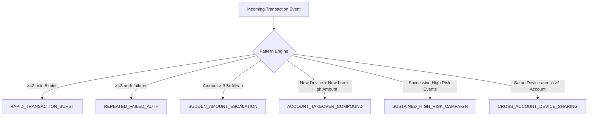

# Advanced AI Intelligence & Investigation Architecture

This document describes the Phase 7 intelligence extensions implemented in the **Real-Time AI Fraud & Risk Decision Engine**, detailing customer behavioral profiling, cross-transaction attack pattern detection, explainable risk decomposition, and investigation workflows.

---

## 1. Customer Behavioral Profile Engine

The customer profiling engine continuously derives historical behavioral baselines directly from stored transaction ledgers in MongoDB:

```
┌─────────────────────────────────────────────────────────────┐
│                 Customer Transaction Ledger                 │
└──────────────────────────────┬──────────────────────────────┘
                               │ Aggregation
                               ▼
┌─────────────────────────────────────────────────────────────┐
│                 Behavioral Baseline Profile                 │
├─────────────────────────────────────────────────────────────┤
│ • Amount Metrics: Mean (μ), StdDev (σ), Median, Min, Max    │
│ • Diurnal Activity: 24-Hour Transaction Frequency Histogram │
│ • Geographic Footprint: Common Cities, Countries & Radius   │
│ • Device Fingerprints: Hardware IDs, Browsers, OS Profiles  │
│ • Decision Velocity: Historical Allow / Review / Block Rate │
└─────────────────────────────────────────────────────────────┘
```

### Statistical Metrics Calculated
- **Amount Z-Score**: $Z = \frac{\text{Amount} - \mu}{\sigma}$, identifying outlier payment magnitudes.
- **Novelty Flags**: Automated identification of first-seen devices, uncustomary geolocations, and off-hour temporal spikes (e.g., 03:00 AM transactions for daytime-only users).

---

## 2. Seven-Factor Risk Decomposition ("Why This Transaction Is Risky")

Every evaluated event is deconstructed into 7 distinct anomaly dimensions with quantitative attribution:

| Anomaly Factor | Assessment Criteria | Risk Weight |
|---|---|---|
| **Amount Anomaly** | Distance from customer $\mu$ and standard deviation tiers ($>3\sigma$) | High |
| **Device Anomaly** | Unregistered hardware ID or sudden user-agent mismatch | Medium-High |
| **Location Anomaly** | Distance leap vs typical customer geolocation cluster | High |
| **Time Anomaly** | Activity outside customary 24-hour diurnal profile | Medium |
| **Velocity Anomaly** | High transaction burst ($\ge 6\text{ tx/hour}$) | High |
| **Failed Attempts** | Elevated sequential authentication / PIN failures ($\ge 3$) | Critical |
| **Behavioral Deviation** | Multi-feature composite deviation from ML baseline | High |

---

## 3. Multi-Transaction Attack Pattern Detection

Rather than evaluating transactions in complete isolation, the **Cross-Transaction Pattern Detector** analyzes sequences across rolling temporal windows:



### Supported Signatures:
1. **`RAPID_TRANSACTION_BURST`**: Card testing or automated bot script firing transactions in rapid succession.
2. **`REPEATED_FAILED_AUTH`**: Credential stuffing or brute-force PIN guessing attempts.
3. **`SUDDEN_AMOUNT_ESCALATION`**: Low-value probe followed by an abrupt massive funds extraction.
4. **`ACCOUNT_TAKEOVER_COMPOUND`**: Triad of unfamiliar device, anomalous IP/location, and elevated transaction amount.
5. **`SUSTAINED_HIGH_RISK_CAMPAIGN`**: Repeated malicious probes targeting the same account over time.
6. **`CROSS_ACCOUNT_DEVICE_SHARING`**: Single device fingerprint executing transactions across distinct accounts (organized fraud ring indicator).

---

## 4. AI Investigation Workbench

The AI Investigation Workbench (`/investigation`) provides fraud analysts with an operational command view:
* **Baseline vs Target Event Matrix**: Granular comparison of normal customer metrics against current event signals.
* **Attack Pattern Highlight Banner**: Surfaces active pattern signatures with actionable triage notes.
* **Interactive Risk Trajectory Timeline**: Chronological risk score evolution chart over lifetime customer activity.
* **Related Transactions Matrix**: Cross-cluster exploration across:
  - Same Customer Account
  - Same Device Fingerprint
  - Same Geographic Coordinates
  - Temporal Incident Window ($\pm 30$ minutes)
* **Operational Recommendation Playbook**: Automated risk response recommendations (e.g., Step-up Biometrics, Outbound Voice Verification, Card Suspension, Device Blacklisting).

---

## 5. Multi-Dimensional Risk Heatmap

Powered by real-time MongoDB aggregation pipelines:
- **Time vs Risk**: 24-hour diurnal risk intensity matrix identifying peak fraud windows.
- **Location vs Risk**: Geographic exposure table ranking high-risk regional clusters.
- **Customer Exposure vs Risk**: Top exposed accounts ranked by cumulative risk and volume.
- **Amount Bracket vs Risk**: Fraud correlation across transaction magnitude tiers.
